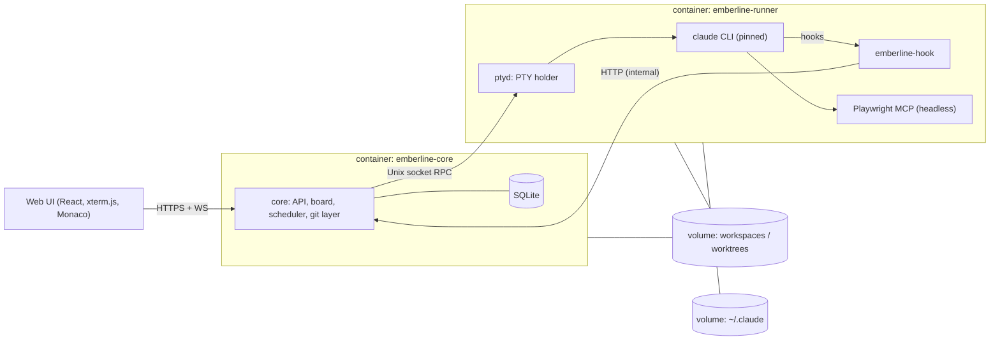
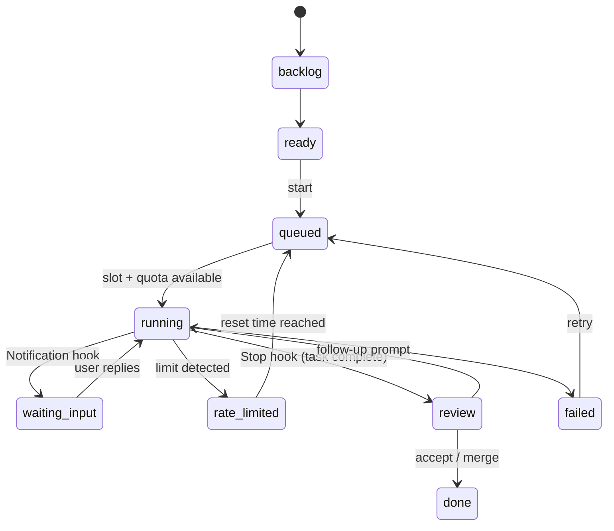

# Project Brief — Self-Hosted AI Coding Orchestrator

> Working name: Emberline
> Status: design locked for MVP. M0–M5 implemented; next is M6 (review + deploy).
> Last updated: 2026-10-12

---

## 1. Problem

Current workflow: VS Code + Claude Code plugin on a local machine, code pushed to GitHub or a self-hosted Gitea, tests run in local Docker or on a TrueNAS homelab. Development is tied to the local machine.

Goals:

- Move development to a self-hosted server (TrueNAS homelab) instead of the local machine.
- Track, schedule and automate coding work remotely, from any device (including mobile).
- Handle the Claude subscription quota: when the 5-hour usage window is exhausted, work must resume automatically after it resets.
- A clear dashboard showing tasks, results, and per-file changes.
- Ticket/kanban workflow (Jira-like) driving the agents.
- Reusable memory across projects so similar designs don't have to be rewritten.

In short: **Jira + VS Code + git client**, with AI coding agents doing the work.

### Non-goals (MVP)

- SaaS hosting, billing, or any shared/managed instance.
- Multiple Claude accounts, account rotation, or quota pooling.
- Building our own editor, terminal emulator, or LLM integration.
- Replacing the forge (Gitea/GitHub/GitLab) — we integrate with it.

## 2. Why build instead of adopt

Evaluated (as of Oct 2026). Each covers part of the need; none covers the combination.

| Tool | Why it doesn't fit |
|---|---|
| OpenHands | Needs an API key for Claude; third-party harnesses can't use the Claude subscription. API cost is too high. |
| Orca (stablyai) | Closest UI. But no quota auto-resume; headless `orca serve` upgrades kill running agent sessions; mobile access to a headless server unclear. |
| herdr | Clean subscription path (real CLI in panes) and has an auto-retry plugin, but terminal-only UI, no board, no multi-user. |
| Omnigent | Governance and multi-user focus; heavy for a single user; subscription path through it unverified. |
| AionUi | Office/cowork oriented; connects Claude Code via ACP (subscription policy risk). |

The gap: **server-first + web UI + runs on the user's own Claude subscription + quota-aware scheduling + ticket-driven work.**

## 3. Decided

### 3.1 Agent execution
- Agents run as the **real Claude Code CLI inside a PTY** managed by the system. No Agent SDK, no API-key path for the core flow.
- Claude first. Other agents (Codex, OpenCode, etc.) later, behind a common adapter interface (§5.3).
- The user logs in once with `claude login` from a web terminal inside the runner during first-run setup. Credentials live in a persistent volume (`~/.claude`) and never leave the runner.

### 3.2 Distribution and accounts
- **Not SaaS.** Users self-host in their own environment.
- **One installation = one user = that user's own Claude subscription.**
- This must be stated explicitly in the README, the first-run setup screen, and the project wizard. Include a "not affiliated with Anthropic" notice.
- No account rotation or multi-account features, by design.

### 3.3 State detection
- Prefer **Claude Code hooks** (`SessionStart`, `UserPromptSubmit`, `PreToolUse`, `PostToolUse`, `Notification`, `Stop`, `SessionEnd`) for agent state.
- Secondary signal: the session **transcript JSONL** (path delivered in hook payloads) — structured, more stable than screen output.
- Screen parsing only where unavoidable (rate-limit banner, reset time). Isolated inside the Claude adapter, covered by fixture tests per pinned CLI version.

### 3.4 Claude Code version policy
- The runner image pins an exact CLI version; the built-in auto-updater is disabled (`DISABLE_AUTOUPDATER=1`).
- New releases are validated on a single **canary task** (scripted prompt + expected hook/state sequence) before rollout.
- Optional user-controlled auto-update, **off by default**.

### 3.5 Process topology
- **PTY holder (`ptyd`) is a separate process and container** from the core app. Core upgrades/restarts never kill running agents (lesson from Orca's headless mode). See §5.1.

### 3.6 UI testing by the agent
- **Headless Playwright MCP** is attached to every run by default (passed via `--mcp-config`, not written into the repo).
- Screenshots and traces are stored as task artifacts.
- Optional per-task **Xvfb + noVNC** to watch the agent's browser live from the web UI (post-MVP).

### 3.7 Preview environments
- One `docker compose` stack per worktree, collision-free port allocation, resource limits, automatic cleanup when the ticket closes (Phase 2).

### 3.8 Plugins and extension points
- **Out-of-process plugins**: separate processes talking to the core over a defined API. Language-agnostic, crash-isolated. Each plugin declares required permissions in a manifest.
- Extension points: agent adapters, forge providers (Gitea/GitLab/GitHub), MCP bundles, wizard templates, notifiers (Telegram, ntfy, push, ...).
- MVP ships built-in implementations **behind the same interfaces**; the plugin host itself lands in Phase 2.

### 3.9 Editor and terminal
- **xterm.js** for terminals (with `@xterm/headless` server-side for screen state).
- **Monaco** (diff editor) in the MVP for review and light edits.
- **code-server** as an optional, embedded full editor later (plugin).

### 3.10 Memory
- File-based first: `CLAUDE.md` per repo, a decision log per project, a cross-project **pattern library** (markdown snippets/templates with tags). Vector store only if proven necessary.

### 3.11 Wizard
- Deterministic templates first (project type, where it's served, tech stack → repo skeleton, `CLAUDE.md`, `docker-compose`, CI). AI-customized templates later.

### 3.12 Stack
- **TypeScript full-stack**, **pnpm** monorepo, Node.js LTS.
- Backend: **Fastify**, **node-pty**, WebSockets, **SQLite** (Drizzle ORM, WAL mode), **zod** for every wire contract.
- Frontend: **React + Vite**, xterm.js, Monaco. Responsive, installable as a PWA for mobile.
- Tests: Vitest (unit), Playwright (e2e).

### 3.13 Auth (MVP)
- Single user. Password set during first-run setup (argon2id hash), HTTP-only session cookie, CSRF protection on mutating routes.
- Remote access is expected behind a reverse proxy or Tailscale; the app does not terminate TLS itself.
- Multi-user (Phase 4) extends this with OIDC (Authentik/Authelia/etc.).

### 3.14 Development approach
- **Phased** delivery with strict boundaries; every milestone ends in something runnable.
- **Modular, plugin-style** architecture.
- Code, comments, docs and UI are in **English**.
- **Docker-only**: development, tests, builds and runtime all happen in containers (single multi-stage `Dockerfile`, `compose.yaml` for self-hosting, `compose.dev.yaml` + `Makefile` for development). The host needs only Docker.

## 4. Proposed (not yet confirmed)

- **Notifications in MVP:** a single built-in ntfy/webhook notifier for "blocked", "rate-limited", "resumed", "done". Others as plugins.
- **Plugin transport:** JSON-RPC 2.0 over stdio (spawned plugins) or Unix socket (long-running plugins); manifest in `emberline-plugin.json`.
- **Concurrency default:** 2 parallel runs per installation (shares one subscription quota), user-configurable.

## 5. Architecture

### 5.1 Topology



- **emberline-core** — stateless apart from SQLite; safe to restart/upgrade at any time.
- **emberline-runner** — `ptyd` + Claude CLI + git + Playwright + toolchains. Rarely restarted; upgrades are explicit and wait for idle.
- On core restart it reconnects to `ptyd`, lists live sessions, and reconciles with the DB.

### 5.2 `ptyd` (PTY holder)
- RPC over a Unix socket (length-prefixed JSON, zod-validated): `spawn`, `list`, `attach` (stream), `write`, `resize`, `snapshot`, `kill`.
- Each session keeps an `@xterm/headless` instance as the source of truth for screen state; `snapshot` returns a serialized screen so the UI can restore instantly on reconnect.
- Raw output is appended to a per-session log file (bounded) for audit and replay.
- Knows nothing about tickets or Claude — it is a generic, dumb, reliable process host.

### 5.3 Agent adapter contract

```ts
interface AgentAdapter {
  id: string;                                   // "claude"
  start(ctx: RunContext): Promise<SessionRef>;  // spawn CLI in a worktree via ptyd
  send(session: SessionRef, input: string): Promise<void>;
  state(session: SessionRef): AgentState;       // derived from hooks + transcript + screen
  onEvent(cb: (e: AgentEvent) => void): Unsubscribe;
  resume(session: SessionRef): Promise<SessionRef>; // after rate limit / crash
  stop(session: SessionRef): Promise<void>;
}

type AgentState =
  | "starting" | "working" | "waiting_input"   // needs a prompt or permission
  | "rate_limited" | "done" | "failed";
```

Claude specifics:
- Per run, a `settings` file passed with `--settings` wires every hook to `emberline-hook <event>`; the hook reads the JSON payload from stdin and posts it with `EMBERLINE_RUN_ID` to core.
- Resume order: if the PTY is alive, send a continue prompt; otherwise `claude --resume <session_id>` in the same worktree.
- Permission mode is configurable per project (`default` / `acceptEdits` / fully unattended inside the isolated runner).

### 5.4 Ticket and run state machine



A ticket can have many runs; the ticket column mirrors its latest run.

**As implemented in M4:** ticket columns are `backlog / ready / in_progress / review / done`; the run's live state (working, needs you, failed) is shown as a pill on the card instead of separate columns. Start goes straight to `in_progress` (no `queued` yet), a `Stop` hook moves the ticket to `review`, a follow-up prompt moves it back, and runs never pull a ticket out of `done`. `queued`, `rate_limited` handling and `--resume` of ended sessions arrive with M5. Since M5 a started ticket stays `in_progress` while its run is `queued` or `rate_limited`, and a follow-up on a ticket whose session ended resumes it with `--resume`.

### 5.5 Quota scheduler
- One global lane (one subscription). Max concurrent runs is configurable.
- On rate-limit detection in **any** run: mark the window exhausted, pause dispatch, move affected runs to `rate_limited`.
- Reset time is parsed from the CLI message (timezone-aware). If parsing fails: probe with a minimal check every 15 min.
- At reset + small jitter: resume runs in priority order, then continue the queue.
- Records every window (start, exhaustion, reset) to learn usage patterns and to plan long jobs into windows later.
- All scheduled work is persisted in SQLite, so a core restart doesn't lose timers.

**As implemented in M5:**
- Every run is created `queued`; the scheduler launches it when a slot is free and no quota window is open. Slots count `starting`/`working` runs (plus a run whose initial prompt hasn't been submitted yet); `waiting_input` doesn't hold a slot. Default concurrency 2, max 8.
- Detection: Claude Code's `StopFailure` hook (`error: rate_limit`) is the primary signal; a short limit banner as `last_assistant_message` on `Stop` also counts. The reset time comes from the hook message, else from the terminal screen ~1.5 s later (`resets 2pm (Zone)`, `resets Oct 13, 2pm`, `resets in Xh Ym`, epoch). Wall-clock times without a zone use `EMBERLINE_TIMEZONE` / `TZ`.
- Windows live in `quota_windows` (`exhausted_at`, `resets_at`, `resume_at`, `source` = hook/screen/probe, `resumed_at`). Resume time = reset + 30–120 s jitter, or now + 15 min when unknown (the probe is simply a resume attempt). A limit within 5 min of a resume reopens the same window.
- Resume: a live PTY gets "Continue where you left off." typed in; an ended session is respawned with `claude --resume <session>`. Rate-limited runs go first, then the queue, each ordered by ticket priority then age.
- Not yet: ntfy/webhook notifications and usage-pattern planning.

### 5.6 Git layer
- Each project has a bare clone; each run gets a **git worktree** on branch `emberline/<ticket-key>-<slug>`.
- Per-worktree diff (staged/unstaged/against base), commit, push.
- MR/PR creation via forge providers (Phase 2). Emberline never pushes to protected/default branches.

### 5.7 Data model (MVP)

| Table | Key fields |
|---|---|
| `projects` | id, name, repo_url, default_branch, local_path, settings_json |
| `tickets` | id, project_id, key, title, body, status, priority, position |
| `runs` | id, ticket_id, agent, state, worktree_path, branch, ptyd_session_id, agent_session_id, started_at, ended_at |
| `run_events` | id, run_id, ts, source (hook/screen/transcript/user/system), type, payload_json |
| `quota_windows` | id, started_at, exhausted_at, resets_at, source |
| `scheduled_jobs` | id, kind, run_at, payload_json, status |
| `artifacts` | id, run_id, kind (screenshot/trace/log/diff), path, meta_json |
| `settings` | key, value_json |

### 5.8 Repository layout

```
apps/
  core/            Fastify API, WS gateway, scheduler, git layer, SQLite
  web/             React + Vite UI
  ptyd/            PTY holder daemon
packages/
  protocol/        zod schemas + types: ptyd RPC, hook events, REST/WS API
  adapter-sdk/     AgentAdapter interface + test harness
  adapter-claude/  Claude Code adapter (hooks, transcript, screen parsers)
  hook/            emberline-hook CLI
deploy/
  docker-compose.yml
  core.Dockerfile
  runner.Dockerfile
docs/
```

### 5.9 UI/UX Workbench & Competitive Feature Set
Learned from evaluating adjacent orchestrators (`stablyai/orca`, `herdr` + `herdr-board`, `AionUi`, `Omnigent`, `Vibe Kanban`, `Conductor`):

- **Unified ADE Workbench (Orca / Linear / Conductor):** Full-viewport IDE shell replacing isolated web pages. Left collapsible sidebar (Projects & Boards, Fleet Multiplexer, Attention Inbox for `waiting_input` runs, Shell Terminals, compact Quota bar), central workspace, and a **Docked Live Terminal & Run Inspector** that opens alongside the board or overview without losing page context.
- **Precision Dark Design System v2 (Linear / Zed / Ghostty):** High-density obsidian/graphite surfaces (`#090a0d` / `#101217`), crisp `1px` structural borders, zero decorative background blurs, tabular numerals, and semantic ember/status accents reserved for live state and primary actions.
- **Command Palette (`⌘K` / `Ctrl+K`, AionUi / Linear):** Instant keyboard navigation to any project board, fleet view, active run, terminal, or quick action (create ticket, start run, open shell, resume quota).
- **Live Terminal + Hook Event Timeline:** Every run/ticket inspector shows both the live `xterm.js` terminal and the structured `run_events` timeline (`PreToolUse`, `PostToolUse`, `Notification`, `Stop`, `StopFailure`, `UserPromptSubmit`) with tool names and timestamps.
- **Fleet / Grid Multiplexer (`/fleet`, Herdr / Orca):** Side-by-side live terminal grid (`1x1`, `2x2`, focus split) for supervising parallel runs at once, with an **Attention Filter** (`waiting_input` / `rate_limited`) and inline quick-prompt bar per pane.
- **Pipeline Columns & Stage Prompt Templates (`herdr-board` / Omnigent):** Dragging a ticket into `in_progress` can auto-dispatch a run; one-click stage templates (*Plan & Analyze*, *Implement*, *Verify & Tests*, *Self-Review*) streamline multi-step steering and critic passes.
- **Annotated Diff Review (M6, Orca / Vibe Kanban):** Monaco diff view against the base branch with line-level review comments that compile into a single structured follow-up prompt sent back to the agent, plus stage/commit/push and worktree artifact browsing.

## 6. Phases

1. **MVP (single user):** core, `ptyd`, Claude adapter, persistent PTYs, quota auto-resume, unified ADE workbench, fleet multiplexer, pipeline board, annotated worktree diff, headless Playwright MCP, single `docker compose` deploy.
2. **Forge + plugins:** Gitea / GitLab / GitHub sync, MR/PR creation, CI status; out-of-process plugin host; per-worktree preview environments; canary automation; notifiers; cron/scheduled maintenance runs.
3. **Memory and wizard:** pattern library, decision logs, deterministic templates; code-server plugin; Xvfb + noVNC.
4. **Multi-user and additional agents:** OIDC, per-user installations or roles, Codex/OpenCode adapters, cross-agent review pipelines.

### 6.1 MVP milestones

| # | Milestone | Done when |
|---|---|---|
| M0 | Monorepo scaffold | `pnpm i && pnpm build && pnpm test` green; lint, typecheck, CI. |
| M1 | `ptyd` | Spawn a shell, attach from two clients, restart a client, screen restored from snapshot. |
| M2 | Core + web terminal | First-run setup (password), login, project registration, live xterm.js terminal through core. |
| M3 | Claude adapter | Run `claude` in a worktree; hooks drive `working` / `waiting_input` / `done` in the UI. |
| M4 | Board | Create ticket → start run → column follows run state; follow-up prompts from the ticket. |
| M5 | Quota scheduler | Rate limit (fixture-simulated + real) pauses dispatch and auto-resumes at reset. |
| M5.1 | Workbench UI v2 | Precision Dark theme, left sidebar shell, `⌘K` command palette, docked live terminal + hook event timeline, run `title` exposure. |
| M5.2 | Fleet & Pipeline | `/fleet` multi-terminal grid multiplexer with attention filter; pipeline board auto-start on drop to `in_progress` + stage prompt templates. |
| M6 | Review + deploy | Monaco diff + inline diff annotations sent to Claude, commit/push branch, artifacts view, `docker compose up` on TrueNAS. |


## 7. Open questions

- ~~**Name.**~~ Decided: **Emberline**.
- ~~**License.**~~ Decided: **AGPL-3.0-or-later** for the application. `packages/protocol` and `packages/adapter-sdk` are **Apache-2.0** so out-of-process plugins/adapters can choose any license.
- Plugin model details: confirm transport and permission model (§4) before Phase 2.
- Preview environment design: port range, CPU/RAM limits, cleanup policy.
- How multi-user maps onto "one installation = one subscription" (separate runners per user?).

## 8. Risks

- **Subscription policy:** Anthropic's terms for automated use of the Claude subscription have been changing during 2026. The project's core value depends on it. Mitigation: always run the official CLI; keep unattended prompting minimal and transparent; follow policy changes.
- **Fragile detection:** CLI output and behavior change between releases. Mitigation: hooks first, transcript second, screen last; version pinning; canary validation; fixture tests per version.
- **Security:** agents run commands on the host. Mitigation: agents only inside the runner container; no production credentials in the agent environment; scoped forge tokens; protected branches; per-task worktrees; no Docker socket in the runner until preview environments are designed (Phase 2).
- **Native dependency:** `node-pty` requires a native build. Mitigation: build inside the runner image; pin Node version.
- **Scope creep:** strict phase boundaries; MVP solves the core problem alone.