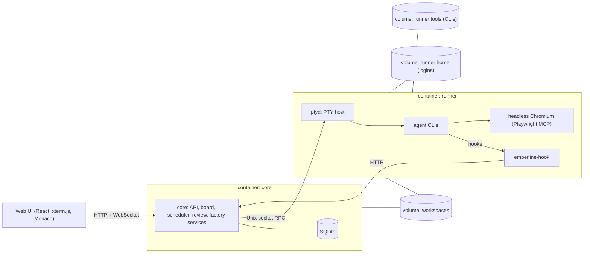

# Emberline design

This document explains why Emberline is built the way it is. For installation and day-to-day use, see the [README](../README.md).

## 1. Problem

A common AI coding setup ties development to one laptop: an editor with an agent plugin, code pushed to a forge, tests run in local Docker. Emberline moves that work to a self-hosted server and makes it manageable from any device, including a phone:

- Track and schedule coding work as tickets, and let agents work them.
- Survive subscription usage limits: when a usage window runs out, work resumes on its own after the reset.
- Review every change before it lands, per file and per line.
- Keep agents running while the web app itself is upgraded.

In short: an issue tracker, an editor and a git client, with AI coding agents doing the work.

### Non-goals

- SaaS hosting, billing or any shared or managed instance.
- Multiple accounts per provider, account rotation or quota pooling.
- Our own editor, terminal emulator or LLM integration.
- Replacing the forge (GitHub, GitLab, Gitea). Emberline integrates with it.

## 2. Principles

### 2.1 Real CLIs, your own logins

Agents run as the **official CLIs inside a PTY**: Claude Code, Codex, Gemini CLI, Antigravity, GitHub Copilot CLI and Aider. Emberline does not reimplement an agent and does not call model APIs on the user's behalf. The user logs in to each CLI once inside the runner; credentials live in the runner's home volume and never leave it.

### 2.2 One installation, one user

Emberline is self-hosted. **One installation = one user = that user's own subscriptions.** There are no account sharing, rotation or multi-account features, by design. The README and the first-run screen say so, together with a notice that the project is not affiliated with any provider.

### 2.3 Agents outlive the app

The PTY daemon (`ptyd`) runs in a separate container from the API. Upgrading or restarting core never kills a running agent; on start, core reconnects to `ptyd`, lists the live sessions and reconciles them with the database.

### 2.4 Core runs nothing in a workspace

Core is the only process with the database and the provider secrets, so it never executes workspace code. Git, package installs, builds, tests and CLI installs all run in the runner through `ptyd`, and the core image ships without git, ssh or build toolchains. Git calls also disable repository hooks and command-running config, so a repository cannot run code with the runner's credentials.

### 2.5 Docker only

Development, tests, builds and runtime all happen in containers: one multi-stage `Dockerfile`, `compose.yaml` for self-hosting, and `compose.dev.yaml` with a `Makefile` for development. The host needs only Docker.

## 3. Architecture

### 3.1 Topology



- **core** holds all state in SQLite and is safe to restart at any time. It mounts the runner's home and tools volumes read-only, only to show login status and installed CLI versions.
- **runner** is a generic Ubuntu developer environment with `ptyd`, Node, Python, Go, Rust, Chromium and the agent CLIs. It is rarely restarted.
- The agent CLIs are installed on demand into the `runner-tools` volume, so they survive image rebuilds and can be updated from the UI without rebuilding.

### 3.2 `ptyd`

- RPC over a Unix socket (length-prefixed JSON, validated with zod): `spawn`, `list`, `attach` (stream), `write`, `resize`, `snapshot`, `kill`.
- Each session keeps an `@xterm/headless` instance as the source of truth for the screen; `snapshot` returns the serialized screen so a reconnecting client restores instantly.
- Raw output is appended to a bounded per-session log.
- It knows nothing about tickets or agents: a generic, simple process host.

### 3.3 Agent adapters

Every provider builds a launch spec (command, arguments, environment, files) for one session:

- **Claude Code** gets a per-run settings file through `--settings` that wires every hook to `emberline-hook <event>`. The hook posts the payload with the run id and a per-run token to core, which drives the run state. MCP servers (Playwright, user-configured) are passed with `--mcp-config` and never written into the repository.
- **Other CLIs** run through a generic wrapper that reports start, completion and failure through the same hook endpoint.
- State detection prefers hooks, then the session transcript, and uses screen parsing only where unavoidable (usage-limit banners and reset times), covered by fixture tests.
- Resume: a live PTY gets a continue prompt typed in; an ended session is restarted with the CLI's resume flag in the same worktree.
- Provider API keys are scoped to the agent that uses them: Claude gets the Anthropic key, Codex the OpenAI key, Gemini and Antigravity the Gemini key.

The adapter contract lives in `packages/adapter-sdk`, the wire schemas in `packages/protocol`. Both are Apache-2.0 so third-party adapters can use any license.

### 3.4 Tickets and runs

Ticket columns are `backlog`, `ready`, `in_progress`, `review` and `done`. A ticket can have many runs; the run's live state (queued, working, needs you, rate limited, failed) is shown on the card.

- Starting a ticket creates a `queued` run on its own git worktree (`/workspaces/.worktrees/<project>/<id>`) and branch (`emberline/<key>-<slug>`). Plain directories run in place.
- The ticket stays `in_progress` while its run is queued, working or rate limited. A `Stop` hook moves it to `review`; a follow-up prompt moves it back.
- Marking a ticket done merges the run's branch into the project's main workspace, under a per-workspace lock.
- Runs never pull a ticket out of `done`. Deleting a ticket keeps its runs, branches and worktrees.

### 3.5 Usage-aware scheduler

- One global lane with a configurable concurrency limit (default 2, max 8). Runs waiting for input don't hold a slot.
- When any run hits a usage limit (Claude Code's `StopFailure` hook, or a limit banner on screen), the run turns `rate_limited`, a quota window opens and dispatch pauses.
- The reset time is parsed from the hook message or the screen, time-zone aware. If none can be read, Emberline retries every 15 minutes.
- At reset plus 30 to 120 seconds of jitter, rate-limited runs resume first, then the queue continues, ordered by ticket priority and age. A limit within 5 minutes of a resume reopens the same window.
- Quota windows and scheduled jobs live in SQLite, so a core restart keeps every timer.

### 3.6 Review and integration

- A Monaco diff per run (branch vs. base, staged, unstaged) with stage/unstage per file.
- Line comments are collected and sent back to the agent as one structured revision prompt.
- Commit, push and pull requests to GitHub, GitLab or Gitea. Emberline never pushes to the default branch, and forge tokens are only sent to the configured forge host.
- Optional gates before merge: build, lint and test in the runner; a scan for leftover secrets and debug code over everything the branch changed; and a read-only review of the diff by a different provider's CLI.
- Checkpoints record the main workspace's git history, with rollback and project export.

### 3.7 Data model

| Table                                  | Holds                                                               |
| -------------------------------------- | ------------------------------------------------------------------- |
| `settings`                             | Key/value settings, including provider keys and notification config |
| `sessions`                             | Login sessions (hashed tokens)                                      |
| `projects`                             | Projects, default branch, workspace path, per-project settings      |
| `tickets`                              | Tickets, column, priority, position                                 |
| `runs`                                 | Runs: agent, state, worktree, branch, ptyd session, agent session   |
| `run_events`                           | Hook, screen, transcript, user and system events per run            |
| `quota_windows`                        | Usage-limit windows: exhausted, reset and resume times, source      |
| `scheduled_jobs`                       | Cron-style scheduled jobs                                           |
| `review_comments`, `review_file_views` | Line comments and per-file review state                             |

### 3.8 Authentication

- A single admin account. The password is set during first-run setup, which requires a one-time setup token printed to the server log, and is hashed with argon2id.
- HTTP-only session cookies (`Secure` and `__Host-` prefixed over HTTPS). Mutating API calls need a custom CSRF header and a matching `Origin`. Revoking sessions also closes their WebSockets.
- Emberline does not terminate TLS. Remote access is expected through a VPN or a TLS reverse proxy.

### 3.9 Repository layout

```
apps/
  core/            Fastify API, WebSocket gateway, scheduler, review, factory services, SQLite
  web/             React + Vite UI
  ptyd/            PTY host daemon
packages/
  protocol/        zod schemas and types: ptyd RPC, hook events, REST/WebSocket API
  adapter-sdk/     agent adapter interface
  adapter-claude/  launch specs for Claude Code and the other CLIs, hooks, personas
  hook/            emberline-hook and the CLI wrappers
e2e/               end-to-end smoke test against an isolated stack
```

### 3.10 Stack

TypeScript everywhere in a pnpm monorepo on Node.js LTS. Backend: Fastify, node-pty, WebSockets, SQLite with Drizzle (WAL mode) and zod for every wire contract. Frontend: React, Vite, xterm.js and Monaco. Tests: Vitest, plus an end-to-end smoke test against a real core and runner.

## 4. Open questions

- **Plugins.** Agent adapters, forge providers, MCP bundles, templates and notifiers are built in behind interfaces. An out-of-process plugin host (JSON-RPC over stdio or a Unix socket, with a permission manifest) is planned but not designed in detail.
- **Preview environments.** One compose stack per worktree with port allocation, resource limits and cleanup.
- **Multiple users.** How several users map onto "one installation = one user", for example one runner per user.
- **Runner isolation.** All agents share one user in the runner. Per-project isolation would need separate users or containers.

## 5. Risks

- **Provider terms.** Providers' terms for automated use of subscriptions change. Emberline's value depends on them. Mitigation: always run the official CLIs, keep unattended prompting minimal and transparent, and follow policy changes.
- **Fragile detection.** CLI output and behavior change between releases. Mitigation: hooks first, transcripts second, the screen last, with fixture tests.
- **Security.** Agents run arbitrary commands. Mitigation: agents only in the runner; core runs nothing in a workspace; per-run worktrees; no Docker socket in the runner; protected default branches; scoped forge tokens.
